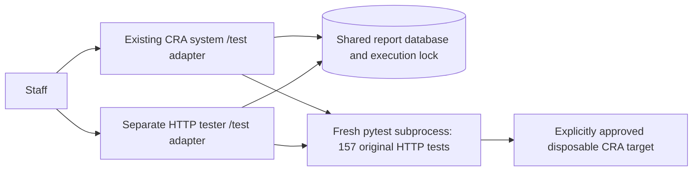

# Team 2 HTTP autograder adapter

This extension is independent Team 2 code. The provisional external reference is
[Team 6 OpenAPI](https://github.com/sanjayriram44/ReleaseGate/blob/9c0b1917b6ed316d51b412685805bd8766b8edea/docs/openapi.yaml)
and [README](https://github.com/sanjayriram44/ReleaseGate/blob/9c0b1917b6ed316d51b412685805bd8766b8edea/README.md),
read October 26, 2026. Only those two documentation files were consulted; no peer
implementation, tests or database design was copied. This is compatibility
evidence, **not documented instructor approval**. Our original CRA contract and
Team 6 fixtures are unchanged. The new interface is specified separately in
`autograder-openapi.yaml`; the Phase 4/5 domain APIs remain outside this increment.

## Confirmed requirements and assumptions

The staff announcement supplied by the user requires distinguishable deployed
system/tester URLs, reachable October 28–29, 2026, and registry updates by
**October 27, 11:59 p.m. Eastern**. Staff append `/test`, `/test/setup`, `/test/run`
and `/test/report`; the shared specification and authentication notes must be
accessible. The announcement does not establish full schemas or execution rules.

We provisionally adopt Team 6's GET discovery, POST setup, synchronous POST run,
GET report, JSON/query input, generated or supplied session identifiers, latest
session defaults, 400/404/409 envelopes, and ready/completed/pass/fail/error
structure. Both roles expose these paths. Confirm this protocol with staff.

Intentional Team 2 choices:

- All **157 unchanged pytest cases** are required. We do not adopt Team 6's smaller
  suite, informational classifications, nested-component implementation or
  "under 30 seconds" performance promise. Historical hosted execution was about
  104 seconds; the subprocess budget is 600 seconds, HTTP deployment budget 900.
- The target is an exact approved origin (optionally entered with `/api/v1`).
  Credentials, arbitrary paths, query strings and fragments are rejected. Only
  operator-configured Team 2/Team 6 targets are allowed, plus explicitly configured
  loopback/container origins for isolated/self testing. No user-controlled shell
  commands, pytest arguments, file paths or executable names are accepted.
  A harness-only pytest plugin checks every prepared request, disables all
  redirects and ignores environment proxies. This includes new sessions used
  by the intentional concurrent test. The original CLI fixtures are unchanged.
- System self-tests use only `http://127.0.0.1:PORT` (8080 by default), never a
  public fallback, remote hostname or different port, even if allowlisted.
  Adapter resets require both the exact `cra_grading` database name in config
  and the actual connection; a retained/course database cannot be selected.
  Our public URL must additionally advertise `role: system, reset_ready: true`
  before the tester launches pytest. An older/unready Team 2 revision is refused
  without issuing a reset. This is an optional Team 2 discovery extension, not a
  requirement imposed on Team 6's independent protocol. Tester discovery returns
  `reset_ready: false`; it does not own a domain database.
- Session IDs contain 1–128 letters, digits, `_`, `.` or `-`. Existing IDs cannot
  be replaced: setup returns 409. Completed run retries return the stored result;
  a new setup/session is required to rerun. A session's target is immutable.
- Setup/run accept JSON objects or equivalent query fields. Conflicting body/query
  fields, unknown fields and invalid input return 400. `now` belongs to system
  setup only; valid RFC 3339 offsets normalize through the original clock model.
  Each unchanged pytest case subsequently resets and sets its own fixture clock.
- Run without an ID uses the latest session; if no session exists, it creates one.
  An explicitly unknown ID returns 404. Reports without an ID use the latest
  session **for that role**. System and tester session IDs need not be shared.
- During execution reports remain `status: ready`, with `running: true` and no
  success result. This preserves the reference status enum. Timeouts, incomplete
  collection, missing XML, fixture errors and interruptions return `result: error`.
  These are extensions/clarifications, not newly agreed pod requirements.
- Configuration/storage failures return a non-secret 503 envelope. Setup collisions
  return 409 as well as active-run collisions. These extra responses are documented
  in our extension; they do not alter the original CRA API errors.

## How it works



Both services use our `cra-service/autograder/` package. The system also serves a
JSON homepage. Its adapter calls a separate, opt-in reset function; the original
`/api/v1` routes retain their behavior. System setup verifies the connected
database is `cra_grading`, then resets domain data and applies an optional clock in one SQL
transaction. The domain schema is unchanged. Tester setup only selects a target;
run executes the existing suite, which resets that target before **every case**.

A fresh `python -m pytest cra-service/test_api.py` subprocess writes JUnit and
bounded redacted HTTP evidence in a unique temporary directory. No assertions,
fixtures or parameterizations are rewritten. Runs are sequential; the existing
intentional concurrent SBOM replacement test still runs its own two requests.
The child does not inherit database URL/password/token/credential environment
variables. No target commit is invented: reports identify runner BUILD_SHA when
available and leave target SHA unknown. JUnit determines test outcomes; HTTP
examples alone do not establish passing assertions.

Each check contains a JUnit ID/title, AC group, required/passed flags, expected and
actual assertion outcome, and an HTTP example when available. AC grouping is a
reporting aid; the original test names/assertions are authoritative. Summary
counts expose passed/failed/errors/skipped and required/informational totals.
Skipped/incomplete suites cannot pass. JUnit teardown errors can add extra
records beyond the 157 collected cases. Reports retain per-test outcomes and
representative redacted request/response evidence; complete temporary log/XML/body
files are removed after parsing, not retained as durable downloadable artifacts.

## Persistence and interference boundaries

Use one metadata database, `cra_autograder`, on the **existing** Cloud SQL instance,
shared by both roles and all revisions. It contains only `autograder.sessions`;
no new paid instance, Redis, queue or object-storage service is required. CRA
reset cannot erase it. Reports persist across process/instance restarts and have
no automatic expiry; retain through grading and clean them up manually afterward.

A PostgreSQL session advisory lock permits one adapter setup/run at a time across
both services/targets. Overlapping operations return 409. Ordinary report reads
do not contend for this lock. The runner checks its lock connection while the
child runs and terminates the child if that connection fails. Normal shutdown
terminates active children; hard container termination kills its processes. A
persisted abandoned running record is recovered as completed/error on the next
report/control request. An infrastructure failure may require retrying report
retrieval after database connectivity returns; execution is never resumed halfway.

This mutex protects **cooperating adapters**. Original `/api/v1/test/reset` and
`/api/v1/test/clock` must remain compatible, so direct CLI tests, Team 6's tester
or manual calls can still interfere. A session ID is reporting metadata, not a
private partition of the global release/clock tables. Arrange exclusive target
windows with Team 6 and avoid manual/CLI resets during grading. Under a database
network partition a failed lock connection is detected on the next heartbeat;
there is no distributed fencing of the unchanged domain endpoints.

The evaluation target must contain disposable synthetic data. Adapter controls
default disabled, and reset permission defaults false. Enabling them is an
operator authorization to erase the approved target during runs. For retained
cloud data, create a separate empty grading database and switch only the approved
evaluation revision after review. Do not point local tests at the public service.

## Local checks

Run from the repository root (PowerShell example). The new Compose project uses
ports 18086/18087, its own PostgreSQL volume, and an intentionally broken local
target. It never connects to Cloud SQL or Team 6.

Use a **new project name** for the updated dual-database test configuration.
Its init SQL creates ordinary grading/report roles only on a fresh volume. Do
not reuse/delete an old volume to make initialization run. Earlier stacks using
the single `cra_test` DB are retained and should remain stopped; their setup
does not match the revised test configuration. The original CRA-only Compose
files still use their existing settings and volumes with adapter controls off.

```powershell
python -m pip install -r cra-service/requirements-dev.txt
docker compose -p cra-phase3-autograder-local -f tester-service/docker-compose.test.yml up --build -d --wait
python -m pytest cra-service --allow-reset --base-url http://127.0.0.1:18086 -q
python -m pytest tester-service/tests --ignore=tester-service/tests/test_http.py -q
$env:HARNESS_INTEGRATION='1'
$env:HARNESS_SYSTEM_URL='http://127.0.0.1:18086'
$env:HARNESS_TESTER_URL='http://127.0.0.1:18087'
python -m pytest tester-service/tests/test_http.py -q
python scripts/check_autograder_runtime.py --project cra-phase3-autograder-local
python -m ruff check cra-service tester-service scripts
python -m ruff format --check cra-service tester-service scripts
python -m mypy
docker compose -p cra-phase3-autograder-local -f tester-service/docker-compose.test.yml stop
```

Do not run the CLI suite and adapter HTTP suite simultaneously. To validate
responses against the pinned external documentation as well as our own schema,
download **only that OpenAPI documentation** to an ignored artifact file and set
`TEAM6_AUTOGRADER_SPEC` to its path before `test_http.py`. CI validates our own
extension without depending on mutable external URLs. Actual local results are
recorded in `testing.md`; a locally passing workflow is not a GitHub Actions run.
