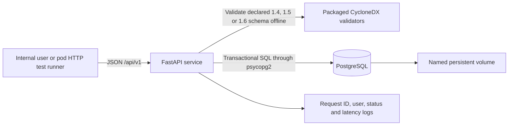
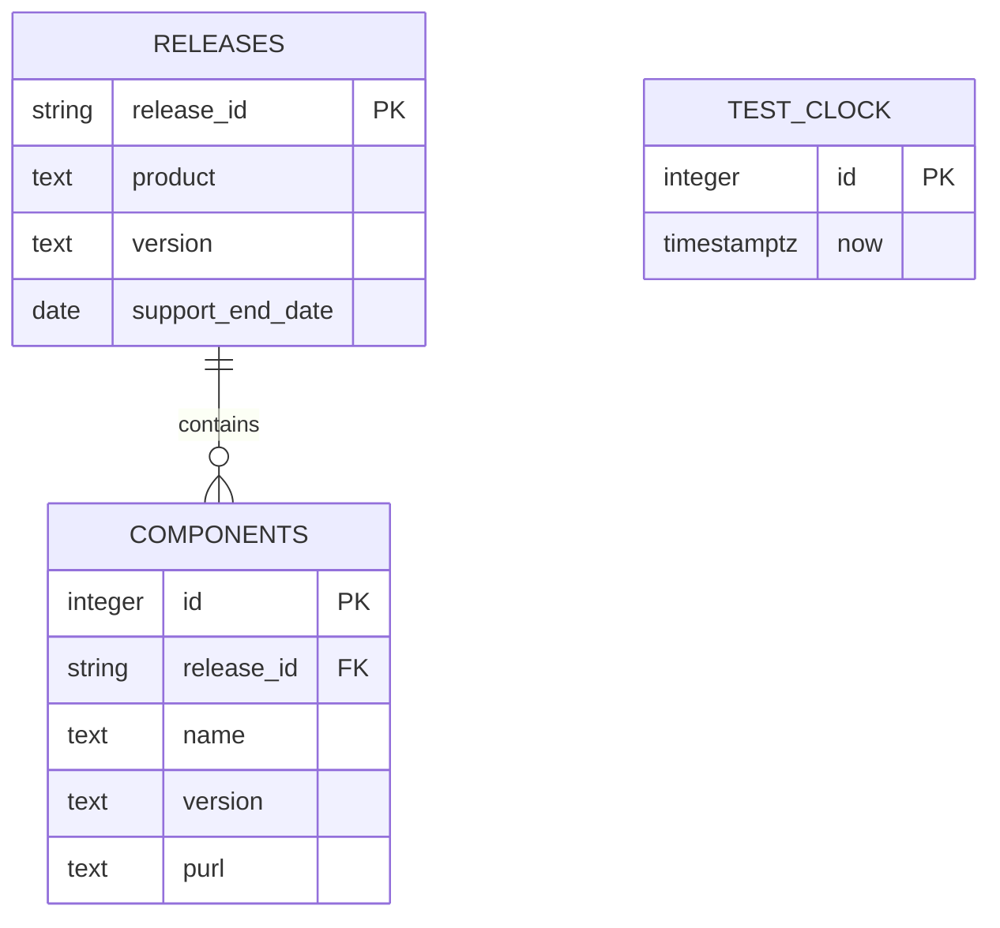
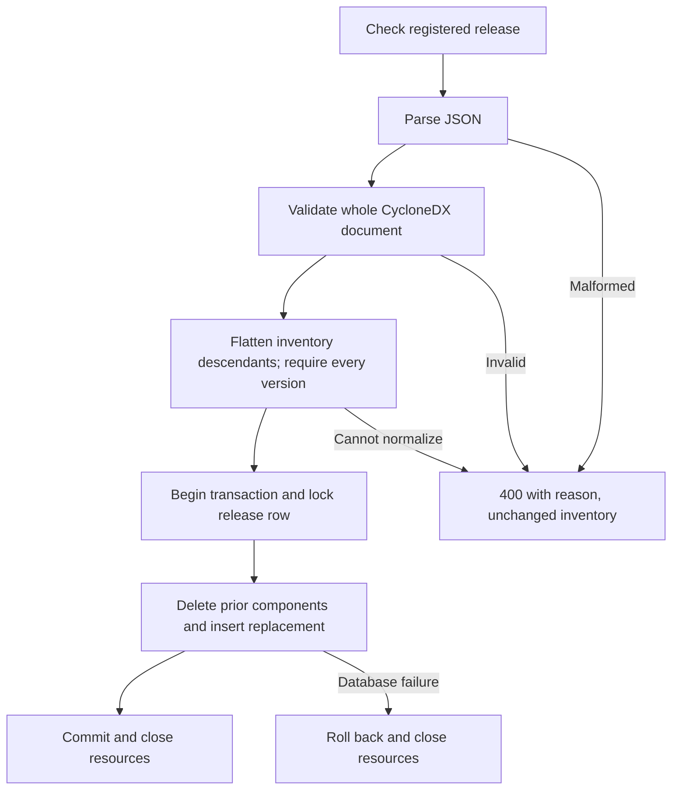

# Implemented Phase 3 models

These models describe actual components. Dependency-Track, incident management,
reports and audit storage are absent from this increment.

## Architecture and request flow

## Persisted data

`(product, version)` is unique. Component foreign keys cascade when releases are
reset. The service uses test-clock row 1; otherwise it uses system UTC. There is
no stored support Boolean, separate raw-SBOM table, or audit table. The nullable
component release foreign key in the existing schema is preserved; the API
always associates inserted components with an existing release.

## SBOM replacement behavior

With the required user header present, unknown releases return 404 before content
type, JSON or schema validation. Whole-document validation precedes traversal of
root `components` and their inventory descendants at every depth. Every inventory
component requires a string version before any replacement SQL is attempted.
Metadata source/tool subtrees are schema validated but excluded from inventory.
Repeated valid occurrences remain separate rows; identical siblings still fail
CycloneDX `uniqueItems`. No API ordering or persisted parent relationship is added.
The existing schema/transaction handles the flat occurrence list without a schema
migration. Old omitted descendants require resubmitting the original SBOM; no
existing records are rewritten by this change. Approval status for exclusion and
occurrence policies is explicit in `decisions.md`.

The Phase 2 design proposed Dependency-Track and more state entities; this model
removes them from the implemented view rather than implying they are running.
Models were checked against `main.py`, its SQL, and Docker Compose configuration.
