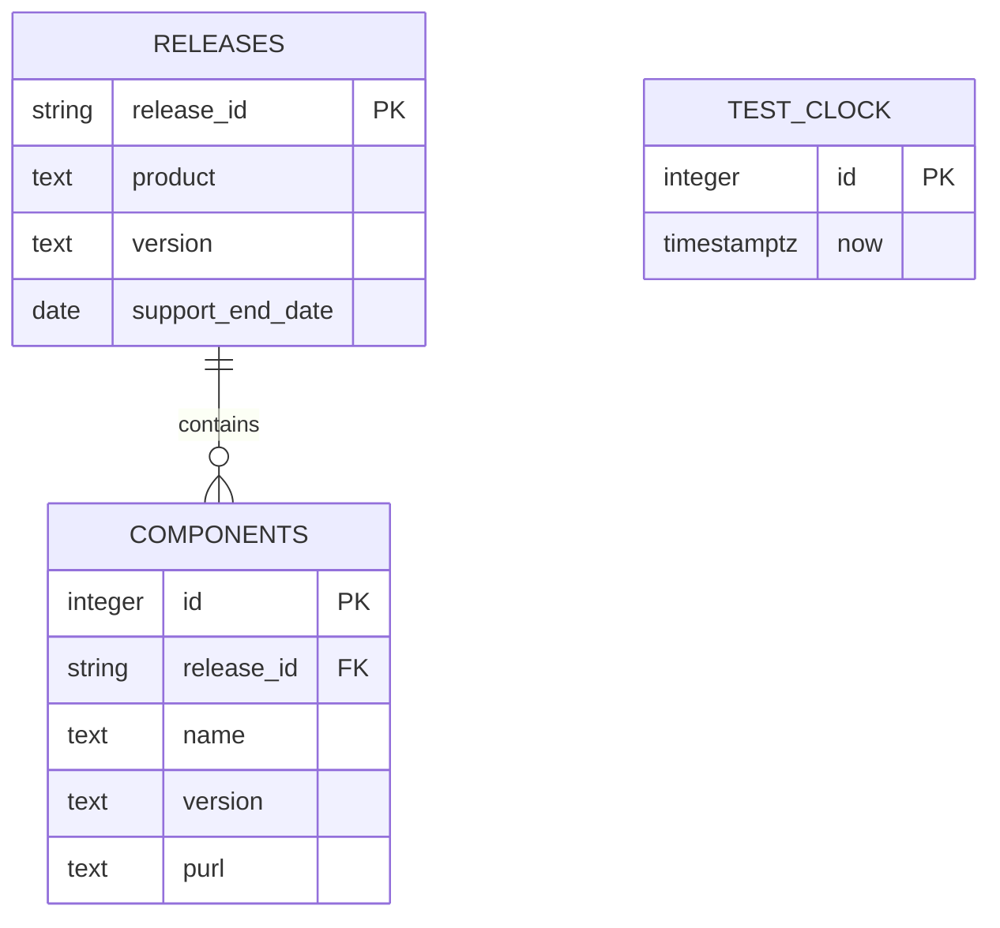
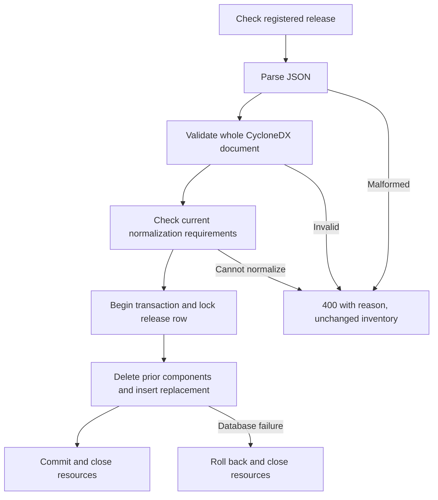

# Implemented Phase 3 models

These models describe actual components. Dependency-Track, incident management,
reports and audit storage are absent from this increment.

## Architecture and request flow

## Persisted data

`(product, version)` is unique. Component foreign keys cascade when releases are
reset. The service uses test-clock row 1; otherwise it uses system UTC. There is
no stored support Boolean, separate raw-SBOM table, or audit table. The nullable
component release foreign key in the existing schema is preserved; the API
always associates inserted components with an existing release.

## SBOM replacement behavior

Unknown releases return 404. Metadata source/tool components are not inventory.
Nested children are validated but not yet normalized into stored rows; that
remaining Phase 3 risk is explicit in `decisions.md`.

The Phase 2 design proposed Dependency-Track and more state entities; this model
removes them from the implemented view rather than implying they are running.
Models were checked against `main.py`, its SQL, and Docker Compose configuration.
