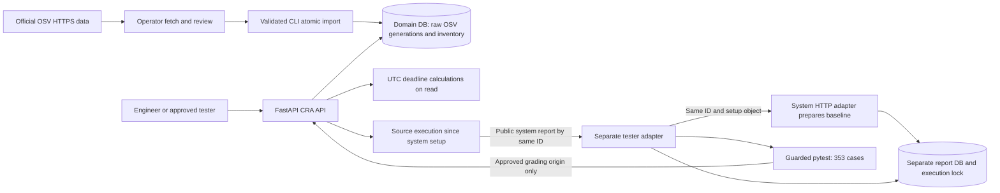
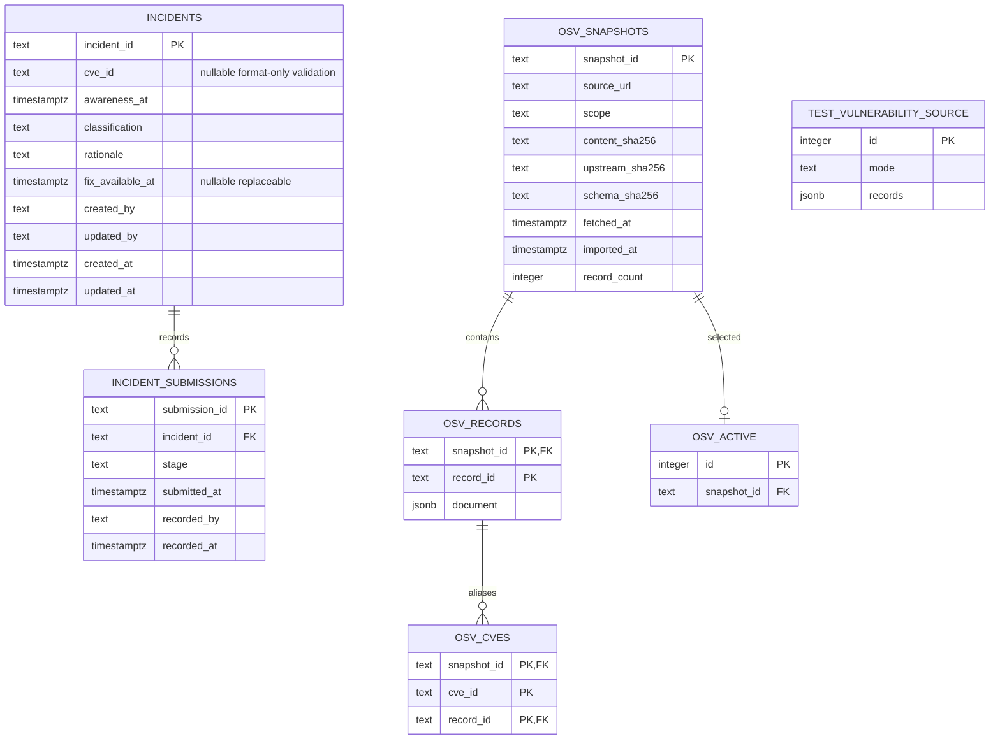
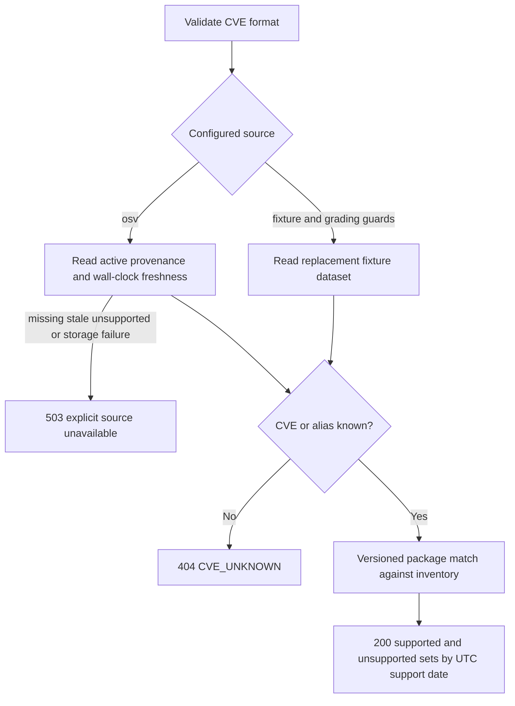
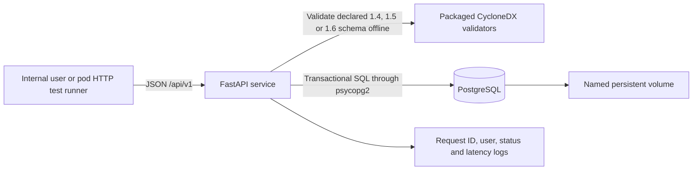
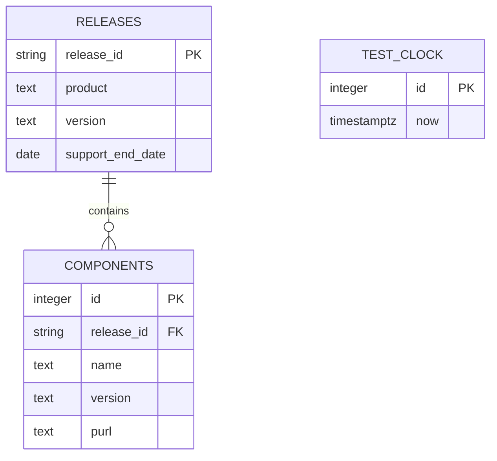
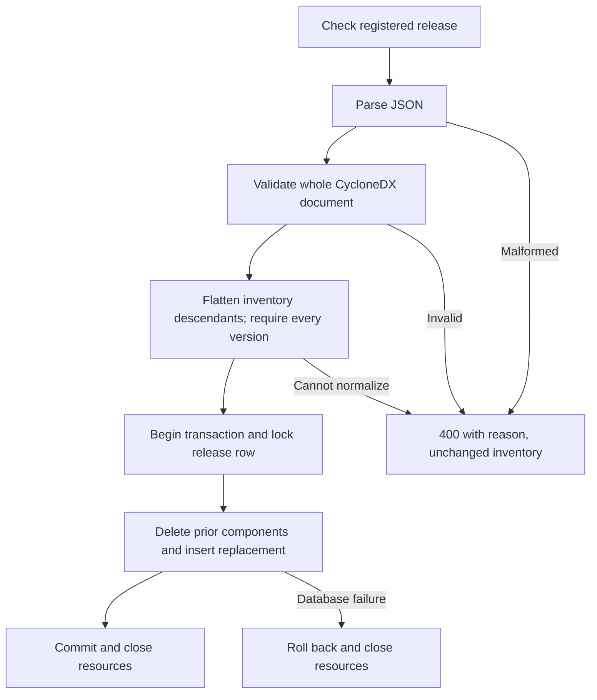
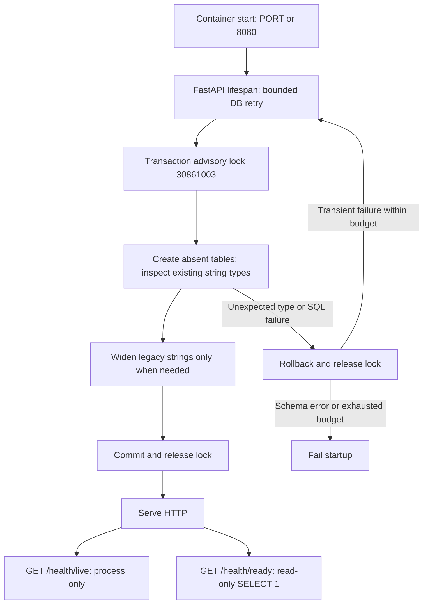
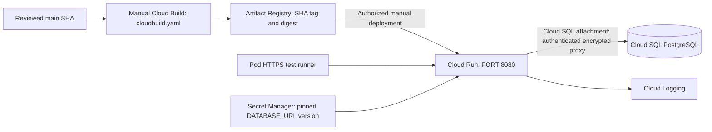

# Implemented CRA models: Phase 4 local increment

November 1, 2026. Local code, not proof of deployment. [Source ADR](adr-0001-osv-snapshots.md).

November 7 interface correction: [coverage definitions](coverage-measures.md)
use real server statement execution, unavailable component counts pending pod
definitions, and the ten pod acceptance criteria. The earlier architecture/model
transition proposal has been retired; the domain models below remain useful
design documentation.

## Architecture

Grading explicitly selects fixture source on disposable cra_grading/cra_test;
production defaults to OSV. They are separate modes, never silent fallbacks.
No external network call occurs during matching. No push alerts or complete audit.

## Additive persistence

Rows/generations are additive; no snapshot deletion on grading reset. Incident
row locks enforce single new submission per stage without deleting legacy rows.
Statuses are derived, not persisted. Mutable attribution is not audit history.

## Query and deadline behavior

Fixture PURLs enumerate exact versions ignoring qualifiers/subpaths. OSV explicit
versions/SEMVER/PyPI ranges apply upstream semantics; unsupported comparisons
fail503. Known but unaffected returns empty200. Both sources preserve stored fields.

Mandatory early/notification deadlines are awareness+24h/+72h. Final is fix+14d
or N/A before a fix. Voluntary stays N/A even with a stored fix. Submission <=due
is met, >due overdue; no submission stays pending through equality. Before-awareness
mutations400, N/A submissions400, duplicates409. Fix replacement recalculates
final status. Existing historical duplicate rows use earliest time, with no rewrite.
The shared YAML proposal is separate and awaits review.

## Historical Phase 3 model notes and unchanged release/SBOM views

The October 26 adapter adds a separate `tester-service` FastAPI process and a
shared Team 2 harness package. The tester launches the unchanged HTTP pytest
suite; system setup prepares its supplied ID and system report measures source
execution. Both store session records in `autograder.sessions`, using one shared
PostgreSQL advisory execution lock. In deployment this belongs in a separate
metadata database on the existing Cloud SQL instance; CRA tables above are
unchanged. See [the adapter lifecycle](autograder-interface.md#calls-and-lifecycle).
These are test execution reports, not Phase 5 regulatory reports or audit records.

## Architecture and request flow

## Persisted data

`(product, version)` is unique. Component foreign keys cascade when releases are
reset. The service uses test-clock row 1; otherwise it uses system UTC. There is
no stored support Boolean, separate raw-SBOM table, or audit table. The nullable
component release foreign key in the existing schema is preserved; the API
always associates inserted components with an existing release.

## SBOM replacement behavior

With the required user header present, unknown releases return 404 before content
type, JSON or schema validation. Whole-document validation precedes traversal of
root `components` and their inventory descendants at every depth. Every inventory
component requires a string version before any replacement SQL is attempted.
Metadata source/tool subtrees are schema validated but excluded from inventory.
Repeated valid occurrences remain separate rows; identical siblings still fail
CycloneDX `uniqueItems`. No API ordering or persisted parent relationship is added.
The existing schema/transaction handles the flat occurrence list without a schema
migration. Old omitted descendants require resubmitting the original SBOM; no
existing records are rewritten by this change. Approval status for exclusion and
occurrence policies is explicit in `decisions.md`.

The Phase 2 design proposed Dependency-Track and more state entities; this model
removes them from the implemented view rather than implying they are running.
Models were checked against `main.py`, its SQL, and Docker Compose configuration.

## Startup and health in the deployment-readiness increment

The initialization lock coordinates new instances/revisions using the same lock;
it does not replace release-row locks used during SBOM replacement. Health routes
are operational endpoints outside the shared `/api/v1` contract and excluded from
generated OpenAPI. Readiness failure returns generic 503; liveness does not depend
on PostgreSQL. Neither endpoint alters the test clock or persisted application data.

## Planned Google Cloud deployment (not deployed or verified remotely)

The runtime account has Cloud SQL Client and secret-specific Accessor. The build
account has separate source/image/log permissions and no DB credentials. No Cloud
Run filesystem persistence is required; PostgreSQL stores releases, components
and clock state. These are proposed cloud resources, not a claim that they exist.
See [the Console guide](deployment-google-cloud.md) for deployment settings and gates.
